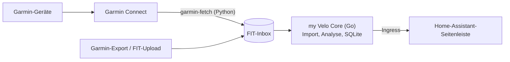

<!-- This code has been fully generated by an AI. -->
# my Velo

Selbst gehostete Auswertung von Rad- und Sportaktivitäten als **Home-Assistant-Add-on**.
my Velo zeigt einzelne Aktivitäten mit Karte, die Historie mit Statistiken und eine persönliche
Heatmap, ohne Abo und ohne zusätzliche Cloud-Plattform. Die Daten stammen aus den Original-FIT-Dateien
der Garmin-Geräte und bleiben lokal auf der Home-Assistant-Instanz.

> **Status: Phase 1 (MVP) in Arbeit – Version 0.4.0.** Aktivitäten lassen sich importieren
> (Upload, Import-Ordner, Garmin-Gesamtexport), filtern, mit Karte und Diagrammen ansehen,
> statistisch auswerten (Dashboard, Jahresziele) und als persönliche Heatmap darstellen.
>
> - **Weitermachen:** [docs/next-steps.md](docs/next-steps.md) – Arbeitsstand, offene Prüfungen, Phase-1-Zuschnitt
> - **Plan und Entscheidungen:** [docs/plan.md](docs/plan.md)
> - **Spike-Ergebnisse:** [docs/spikes](docs/spikes/README.md)

## Ziele

- **Aktivitätsdetails:** Karte, Höhenprofil, Herzfrequenz, Leistung und Trittfrequenz
- **Historie:** Wochen-, Monats- und Jahresstatistik, Jahresvergleich und Ziele
- **Heatmap:** filterbar nach Sportart und Zeitraum, mit OSM-, MapTiler- und Luftbild-Karten
- **Analysen:** Power-Curve, Eddington-Zahl, Explorer-Tiles, Wetter zur Fahrt, Materialverschleiß
- **Datenhoheit:** Original-FIT-Dateien als Quelle der Wahrheit, gespeichert im Add-on

## Architektur in Kürze



Details stehen in [docs/architecture.md](docs/architecture.md).

## Repository-Struktur

| Pfad | Inhalt |
|---|---|
| [`cmd/myvelo`](cmd/myvelo) | Einstiegspunkt des Go-Servers (Ingress-Panel) |
| [`cmd/fitinspect`](cmd/fitinspect) | Werkzeug zum Prüfen von FIT-Dateien und Garmin-Exporten |
| [`internal/`](internal) | Go-Pakete: `web` (Panel, Templates, Browser-Module), `store` (SQLite), `importer`, `fitfile`, `geo`, `sport`, `config` |
| [`garmin-fetch/`](garmin-fetch) | Python-Fetcher für Garmin Connect |
| [`my_velo/`](my_velo) | Home-Assistant-Add-on-Definition |
| [`docs/`](docs) | Plan, Architektur, nächste Schritte, Spike-Ergebnisse, Release-Prozess |

## Entwicklung

Voraussetzungen: Go ≥ 1.26, Python ≥ 3.12, Docker (für das Add-on-Image).

```bash
go test ./...                       # Go-Tests
go run ./cmd/myvelo -dev -data ./data -import-dir ./data/import   # Panel auf http://localhost:8099
go run ./cmd/fitinspect <datei|ordner|zip>   # FIT-Dateien analysieren
```

Für den Python-Fetcher siehe [garmin-fetch/README.md](garmin-fetch/README.md).

## Installation in Home Assistant

Siehe [my_velo/DOCS.md](my_velo/DOCS.md).

## Hinweise

- my Velo nutzt für den automatischen Abgleich die **inoffizielle** Garmin-Connect-Schnittstelle
  über [python-garminconnect](https://github.com/cyberjunky/python-garminconnect). Garmin kann
  diese jederzeit ändern. Der Datei-Import funktioniert unabhängig davon.
- Garmin, fēnix und Edge sind Marken von Garmin Ltd. Dieses Projekt steht in keiner Verbindung zu
  Garmin.
