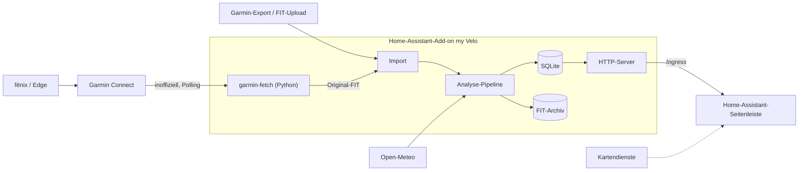
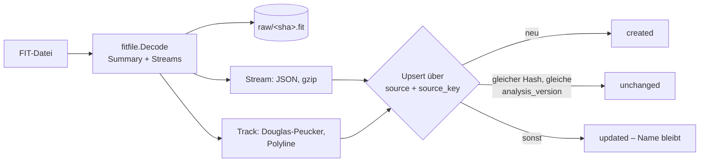

<!-- This code has been fully generated by an AI. -->
# Architektur

Stand: Phase 0. Dieses Dokument fasst die Zielarchitektur zusammen; Herleitung und Alternativen
stehen in [plan.md](plan.md), die Spikes in [spikes/](spikes/README.md) prüfen die riskanten Annahmen.

## Kontext

## Leitentscheidungen

| Thema | Entscheidung | Begründung |
|---|---|---|
| Datenquelle | Original-FIT-Dateien: automatisch aus Garmin Connect oder per Upload/Export | vollständige Daten inkl. Garmin-Feldern, keine weitere Plattform, kein Abo (die Strava-API setzt ein Abo voraus) |
| Sprache Kern | Go | gute Bibliotheken für FIT ([muktihari/fit](https://github.com/muktihari/fit)), Geometrie und SQLite ohne CGO; ein statisches Binary |
| Garmin-Zugriff | Python-CLI `garmin-fetch` mit [python-garminconnect](https://github.com/cyberjunky/python-garminconnect) | einzige gepflegte Implementierung des aktuellen Garmin-Logins; ein Go-Port wäre bei jeder Garmin-Änderung kaputt |
| Kopplung Go ↔ Python | Prozessaufruf, JSON Lines über stdout, Eingaben über stdin | kein zweiter dauerhaft laufender Dienst, keine Zugangsdaten in Argumenten |
| Speicherung | SQLite und FIT-Archiv unter `/data` | Teil der Home-Assistant-Backups |
| UI-Einbindung | Home-Assistant-Ingress (Seitenleiste) | Authentifizierung durch Home Assistant, kein offener Port |
| Frontend | Go-Templates, htmx, MapLibre GL JS, uPlot, ohne Node-Build | einfache Toolchain |
| Karten | MapTiler als Standard, optional Luftbild Bayern (DOP40, CC BY 4.0) | sauber lizenziert; Anbieter konfigurierbar |

## Identität und idempotenter Import

Jeder Import ist ein Upsert über natürliche Schlüssel. Wiederholte Importe erzeugen deshalb keine
Duplikate.

| Ebene | Schlüssel |
|---|---|
| FIT-Aufzeichnung | `fit:<manufacturer>:<serial_number>:<time_created>` aus der `file_id`-Message |
| Garmin-Aktivität | `garmin:<activityId>` |
| Rohdatei | SHA-256 des Inhalts (Rückfallebene) |

Ergebnisse dazu: [spikes/s2-fit-parsing.md](spikes/s2-fit-parsing.md).

## Ingress

Home Assistant leitet das Panel über einen Pfad wie `/api/hassio_ingress/<token>/` an das Add-on
weiter und übergibt diesen im Header `X-Ingress-Path`. Der Server erzeugt deshalb ausschließlich
relative URLs und setzt `<base href>` auf diesen Pfad. Anfragen nimmt er im Add-on-Betrieb nur vom
Supervisor-Proxy `172.30.32.2` an. Details: [spikes/s3-ingress-addon.md](spikes/s3-ingress-addon.md).

## Datenmodell und Import (ab 0.1.0)

Schema: [internal/store/migrations](../internal/store/migrations/). Ablauf je Datei:

| Tabelle | Inhalt |
|---|---|
| `activity` | Kennzahlen, Gerät, Bounding Box, `tz_offset_s`, `analysis_version`; `name` ist vom Nutzer editierbar und wird beim Re-Import nicht überschrieben |
| `activity_source` | natürliche Schlüssel je Quelle, `UNIQUE(source, source_key)` – Grundlage der Idempotenz |
| `activity_stream` | volle Auflösung, spaltenweise, gzip-JSON (`json+gzip;v1`) |
| `activity_track` | vereinfachte Geometrie als Google-Polyline (1e-5) für Übersichten und Heatmap |

Die Originaldateien unter `raw/` sind die Quelle der Wahrheit: Ändert sich die Auswertung, wird
`importer.AnalysisVersion` erhöht und neu abgeleitet, ohne die Dateien erneut zu beschaffen.
