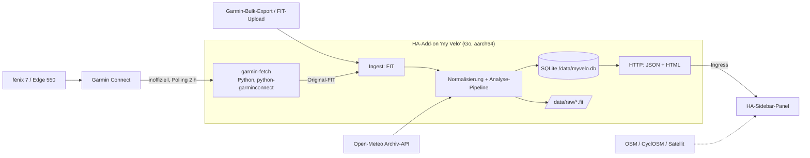
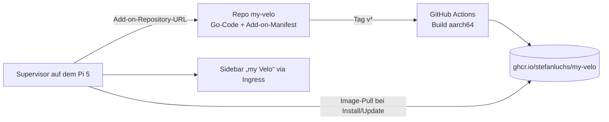

<!-- This code has been fully generated by an AI. -->
# my Velo – Evaluierung, Entscheidungen und Plan

Stand: 22.10.2026. Status: **Phase 0 (Spikes) technisch abgeschlossen**, Prüfungen mit echten
Daten offen. Aktueller Arbeitsstand und nächste Schritte: [next-steps.md](next-steps.md);
Spike-Ergebnisse: [spikes/](spikes/README.md).

Dieses Dokument ist die maßgebliche Fassung des Plans. Es entstand als Evaluierung im
Home-Assistant-Konfigurations-Repository (`docs/fahrrad/aktivitaeten-plan.md`) und wurde mit dem
Projektstart hierher übernommen. Projektstände (Aktivität, Architektur) externer Projekte wurden
am 22.10.2026 über GitHub/Docker Hub geprüft.

## 1. Ziel und Anforderungen

Eigene, lokal betriebene Darstellung der Sportaktivitäten mit Schwerpunkt Rad. Hauptmotiv sind
**Kosten**: Funktionen wie die persönliche Heatmap sollen ohne Strava-Abo verfügbar sein.
Zusätzlich gilt: **Keine weitere Plattform.** Die Daten verlassen die Kette Gerät → Garmin Connect →
my Velo nicht.

| Bereich | Anforderung |
|---|---|
| Aktivitäten | Rennrad, Gravel, MTB, E-Bike, Pendeln; zusätzlich Laufen und Wandern |
| Einzelansicht | Karte, Höhenprofil, Charts für HF, Leistung und Trittfrequenz |
| Historie | Distanz, Höhenmeter und Zeit pro Woche/Monat/Jahr, Jahresvergleich, Ziele |
| Analysen | Power-Curve und Bestleistungen, Eddington-Zahl, Segmente, Explorer-Tiles, Wetter zur Fahrt |
| Material | km pro Rad, Verschleißteile (z. B. Kette) mit Schwellwerten |
| Heatmap | filterbar nach Typ und Zeitraum, OSM- und Satellitenkarte, keine Privatzone nötig |
| Datenumfang | ab 01.01.2026, ca. 100 Fahrten; Bulk-Import einmalig |
| Sync | automatisch per Polling (stündlich bis täglich) plus Knopf „Jetzt synchronisieren“ |
| Zugriff | nur lokal (LAN/VPN), ein Benutzer |
| Einbindung | eigenes Sidebar-Panel in Home Assistant, keine Lovelace-Karten nötig |
| Betrieb | HA-Add-on auf dem Raspberry Pi 5 (8 GB, 500-GB-SSD), Daten in HA-Backups |
| Umsetzung | Eigenentwicklung erwünscht, bevorzugt in **Go**, sofern das Ökosystem passt |

Quellgeräte sind eine Garmin fēnix 7 und ein Edge 550. Sie synchronisieren zu Garmin Connect,
von dort geht es automatisch weiter zu Strava. Strava spielt für my Velo keine Rolle.

## 2. Ausgangslage Home Assistant

- HA OS 2026.10.1 auf einem Raspberry Pi 5 mit Supervisor, d. h. Add-ons mit **Ingress** sind möglich.
- Ein InfluxDB-Add-on ist vorhanden. Für Tracks ist es ungeeignet, weil es keine Geometrie-Abfragen
  bietet und Geodaten mit hoher Kardinalität schlecht verarbeitet. Deshalb nutzt der Plan es nicht.
- Eigene Frontend-Erweiterungen der HA-Instanz sind Vanilla-JS ohne Build-Kette; my Velo folgt diesem Stil.
- Mit 100 Fahrten zu je ca. 1–2 MB Rohdaten ist das Datenvolumen unkritisch.

## 3. Datenquellen – Bewertung

| Quelle | Zugang | Datenumfang | Stabilität | Bewertung |
|---|---|---|---|---|
| **FIT-Dateien** (Garmin-Bulk-Export, USB, Upload) | Datei-Import | vollständig, inkl. aller Garmin-Felder | hoch, Offline-Format | **Basis**, immer verfügbar |
| **Garmin Connect direkt** (inoffiziell) | `python-garminconnect` ≥ 0.3 (Login mit Benutzer/Passwort + MFA, Token-Store) | Aktivitätsliste + **Original-FIT** (Download als ZIP) | **mittel bis gering**: Garmin hat 2025/26 den Auth-Flow geändert und schützt die Anmeldung zusätzlich gegen Bots; die Bibliothek nutzt dafür `curl_cffi` (Browser-TLS-Fingerprint) | **automatischer Sync**, mit FIT-Import als Rückfallebene |
| Strava API | OAuth-App | Streams, Gear, Segmente | – | ❌ **verworfen**: Für eine API-App ist ein Strava-Abo Pflicht („A Strava subscription is a prerequisite for creating an app“, developers.strava.com) |
| intervals.icu | API-Key; Original-FIT über `GET /api/v1/activity/{id}/file` | vollständig | hoch (offizieller Garmin-Partner) | ❌ verworfen: zusätzliche Plattform |
| Garmin Connect Developer Program | offizielle Activity API | vollständig | hoch | ❌ nur für Unternehmen |

### Konsequenzen des Garmin-Direktwegs

- Das Datenmodell basiert vollständig auf **FIT**. Dadurch sind auch Garmin-eigene Felder verfügbar
  (Cycling Dynamics, Training Effect, Schaltdaten, Developer-Felder), mehr als bei Strava.
- Gear, Segmente und Benennung pflegt my Velo selbst; es gibt keinen Strava-Abgleich.
- **Kein Go-Port** des Garmin-Logins: Er bräuchte TLS-Fingerprint-Imitation, die bei jeder
  Garmin-Änderung bricht. Stattdessen läuft im Add-on ein kleiner **Python-Fetcher** auf Basis von
  `python-garminconnect`. Er ist das einzige Python im System, hat eine schmale Schnittstelle und
  lässt sich bei Updates der Bibliothek einfach mitziehen.
- Fällt der Sync aus (z. B. weil Garmin die Anmeldung erneut ändert), funktioniert my Velo
  weiterhin über FIT-Upload. Keine Funktion hängt am Sync.
- Garmin kann inoffizielle Zugriffe theoretisch sanktionieren. Deshalb gilt ein zurückhaltendes
  Polling (Standard alle 2 h) und Downloads nur für neue Aktivitäten.

## 4. Lösungsoptionen – Bewertung

| Option | Beschreibung | Abdeckung | Aufwand | Zuschnitt | Bewertung |
|---|---|---|---|---|---|
| A – Fertige App: **Dreeve** (früher „Statistics for Strava“) als Add-on | PHP/Symfony, Docker-Image arm64; Strava- oder FIT/GPX-Import | sehr hoch: Heatmap, Eddington, Segmente, Gear/Wartung, Monatsansicht | gering (Add-on-Wrapper) | gering, PHP | **Referenz bzw. Fallback** |
| B – Fertige App: **Endurain** als Add-on | Python/FastAPI, direkter Garmin- und Strava-Sync | mittel; Heatmap laut GitHub-Issues noch offen | gering | gering | nicht empfohlen |
| C – garmin-grafana + InfluxDB + Grafana | Garmin-Health-Fokus, Geomap-Panels | Statistik gut, Karten/Heatmap umständlich | mittel | mittel | nicht empfohlen |
| D – HA-nativ (Integration + Lovelace-Karten) | Daten in HA, eigene Karten | frei | hoch; der Recorder ist für Tracks ungeeignet | hoch | nicht empfohlen (Panel genügt) |
| **E – Eigenentwicklung in Go als HA-Add-on mit Ingress-Panel** | Go-Binary + SQLite + Web-UI | frei | mittel bis hoch | **maximal** | **empfohlen** |

**Empfehlung: Option E.** Sie erfüllt den Wunsch nach Eigenentwicklung und Go. Das Go-Ökosystem
deckt die schweren Teile ab (FIT, Geometrie, SQLite ohne CGO). Ein Teil der Arbeit liegt
zwangsläufig im Browser (Karten, Charts). Dreeve kann in Phase 0 per FIT-Import als **Messlatte**
dienen (ohne Strava). Fällt der Funktionsvergleich ernüchternd aus, bleibt Dreeve mit FIT-Import
als Add-on der Plan B; dann allerdings ohne automatischen Sync.

## 5. Zielarchitektur (Option E)

- **Ein Ingest-Pfad:** Alles wird zu FIT, egal ob Upload, Verzeichnis-Import (Bulk-Export) oder
  Garmin-Sync. Der Garmin-Fetcher legt nur Dateien in eine Inbox und liefert Metadaten mit
  (Garmin-Aktivitäts-ID, Name, Typ).
- **Analyse-Pipeline beim Import:** Die Werte werden einmalig berechnet und gespeichert:
  vereinfachte Geometrie für Heatmap und Liste, Power-/HF-Bestwerte über Standarddauern,
  Explorer-Tiles, Wetter und Gear-km.
- **Fetcher-Schnittstelle:** Der Go-Dienst ruft `garmin-fetch` als Prozess auf, z. B.
  `garmin-fetch sync --since <datum> --out /data/inbox`, und liest JSON von stdout. Es gibt keinen
  dauerhaft laufenden zweiten Dienst und kein Netzwerkprotokoll zwischen beiden.
- **Garmin-Login:** Die Erstanmeldung läuft im Panel mit Benutzer, Passwort und MFA-Code
  (`login` → `resume_login`). Gespeichert werden nur die Tokens (`/data/garmin/garmin_tokens.json`),
  das Passwort nicht. Laufen die Tokens ab, zeigt das Panel „Neu anmelden“; optional setzt das
  Add-on dann einen HA-Hinweis (Persistent Notification).
- **Polling:** alle 2 h (konfigurierbar) plus Knopf „Jetzt synchronisieren“. Die Inbox ist
  idempotent, ein abgebrochener Lauf wird einfach wiederholt.
- **Add-on:** `ingress: true`, `panel_icon: mdi:bike`, `arch: [aarch64]`; MapTiler-Key als Add-on-Option
  (Typ `password`). `/data` ist automatisch Teil der HA-Backups.

### 5.1 Identität und idempotenter Import

Jeder Import ist ein **Upsert über natürliche Schlüssel**. Ein Bulk-Import lässt sich deshalb
beliebig oft wiederholen, ohne Duplikate zu erzeugen.

| Ebene | Schlüssel | Eindeutigkeit |
|---|---|---|
| FIT-Aufzeichnung | `fit:<manufacturer>:<serial_number>:<time_created>` aus der `file_id`-Message | laut FIT-Spezifikation identifizieren `serial_number` und `time_created` eine Datei eindeutig; unabhängig vom Dateinamen und vom Weg (Sync, Export, USB) |
| Garmin-Aktivität | `garmin:<activityId>` | stabil in Garmin Connect; ist beim Sync bekannt und steckt voraussichtlich auch im Dateinamen des Bulk-Exports (Spike S2) |
| Rohdatei | SHA-256 des Dateiinhalts | erkennt dieselbe Datei byte-genau; Fallback, falls `file_id` unvollständig ist |
| Logische Aktivität | interne ID (UUID) | eine Aktivität kann mehrere Quellen haben (Tabelle `activity_source`, `UNIQUE(source, source_key)`) |

Da Sync und Bulk-Export **dieselbe Original-FIT-Datei** liefern, fallen beide Wege über den
`file_id`-Schlüssel automatisch zusammen. Ein Abgleich über Startzeit oder Distanz ist nicht nötig.
Der Sync liest die Aktivitätsliste der letzten 7 Tage und lädt die FIT-Datei nur für unbekannte
`activityId`s herunter.

**Doppelaufzeichnung:** Fēnix und Edge zeichnen dieselbe Fahrt eventuell parallel auf. Das ergibt
zwei FIT-Dateien mit unterschiedlicher Seriennummer und zeitlicher Überlappung. Solche Fälle werden
erkannt und als *eine* Aktivität geführt. Bevorzugt wird das Gerät in der Reihenfolge
Edge > fēnix; die Reihenfolge ist konfigurierbar.

**Neuberechnung:** Abgeleitete Werte (Bestwerte, Tiles, Gear-km) sind deterministisch aus den
gespeicherten Streams berechenbar. Sie tragen eine `analysis_version`; ein erneuter Import oder ein
Versionssprung berechnet sie neu, statt sie zu addieren.

**Änderungen in Garmin Connect:** Umbenennungen oder Typwechsel in Garmin Connect übernimmt der
Sync für die letzten 7 Tage. Danach führt my Velo Namen, Typ und Gear selbst. Löschungen in Garmin
Connect löschen in my Velo nichts.

### 5.2 Verdrahtung mit der Home-Assistant-Instanz

1. **Repository einbinden:** Unter *Einstellungen → Add-ons → Add-on-Store → ⋮ → Repositories*
   wird die GitHub-URL des Repos `my-velo` eingetragen. Das Repo enthält `repository.yaml` und den
   Ordner `my_velo/` mit `config.yaml`. Repo und Image müssen **öffentlich** sein, weil der
   Supervisor ohne Zugangsdaten klont bzw. pullt. Secrets liegen nie im Repo.
2. **Installation und Updates:** In `config.yaml` steht
   `image: ghcr.io/stefanluchs/my-velo-{arch}` mit `version`. Ein neuer Git-Tag baut über CI ein
   neues Image. HA zeigt das Update wie jedes andere Add-on-Update an, inklusive Backup vor dem
   Update.
3. **Konfiguration:** Polling-Intervall, Sync an/aus, Kartenanbieter und MapTiler-Key sind
   Add-on-Optionen. Der Garmin-Login (inkl. MFA) läuft einmalig im Panel; gespeichert werden nur
   Tokens in `/data`.
4. **Panel:** Mit `ingress: true`, `panel_title: my Velo` und `panel_icon: mdi:bike` erscheint der
   Eintrag automatisch in der Sidebar. Die Authentifizierung übernimmt HA; das Add-on bekommt
   keinen eigenen offenen Port.
5. **Bulk-Import:** Über `map: [share:rw]` liest das Add-on den Ordner `/share/myvelo/import/`.
   Der Garmin-Export (ZIP oder FIT) wird per Samba- bzw. SSH-Add-on dort abgelegt und im Panel per
   „Import starten“ verarbeitet. Alternativ geht ein Upload im Browser.
6. **Daten und Backup:** `/data` (SQLite, Rohdateien) ist Teil der HA-Backups, die Add-on-Backups
   lassen sich auch einzeln wiederherstellen.
7. **Entwicklungsschleife:** Entwickelt wird lokal mit `go run ./cmd/myvelo -dev`. Ein lokaler
   Add-on-Build auf dem Pi entfällt, weil der Supervisor nur den Add-on-Ordner als Build-Kontext
   nutzt, der Go-Code aber im Repo-Root liegt (Spike S3). Auf den Pi kommen nur getaggte Images
   aus GHCR.
8. **HA-Konfigurations-Repo** bleibt frei von Add-on-Code. Spätere HA-Sensoren (Phase 4)
   veröffentlicht das Add-on über die Supervisor-API (`homeassistant_api: true`), ohne YAML dort.

## 6. Technologie-Stack

| Zweck | Wahl | Begründung |
|---|---|---|
| FIT-Dekodierung | `github.com/muktihari/fit` (v0.28, erfordert **Go ≥ 1.26**) | aktiv gepflegt, FIT Protocol V2, schnell (100.000 Records in 0,4 s); Alternative `tormoder/fit` |
| GPX (optional) | `github.com/tkrajina/gpxgo` | Import von Fremddaten |
| Geometrie, Vereinfachung, Tiles | `github.com/paulmach/orb` (`simplify`, `maptile`) | Douglas-Peucker, Slippy-Tiles für Explorer-Tiles |
| Datenbank | SQLite über `modernc.org/sqlite` | CGO-frei, dadurch einfacher arm64-Cross-Build |
| Garmin-Sync | `python-garminconnect` (≥ 0.3) im Fetcher `garmin-fetch`, aufgerufen per `os/exec` | einzige gepflegte Bibliothek mit dem neuen Garmin-Login; Basis-Image `python:3.13-alpine`, da alle Abhängigkeiten inkl. `curl_cffi` musllinux-aarch64-Wheels liefern (Cross-Install ohne QEMU, Spike S1) |
| Wetter | Open-Meteo Historical API | kostenlos, ohne Key, stündlich je Startpunkt/-zeit |
| Web-UI | Go `html/template` + htmx, ES-Module ohne Build-Kette | passt zum Vanilla-JS-Stil der HA-Instanz |
| Karten | MapLibre GL JS | Linien-Heatmap clientseitig (additive Transparenz), Filter ohne Server-Rundlauf |
| Charts | uPlot (Zeitreihen) bzw. ECharts (Statistik) | leichtgewichtig |
| Basiskarten | OSM / CyclOSM / OpenTopoMap; Satellit siehe 6.1 | Anbieter konfigurierbar, Attribution immer sichtbar |

**Heatmap-Ansatz:** Die Geometrien werden serverseitig vereinfacht und als GeoJSON (später
FlatGeobuf) an MapLibre geliefert. Dort werden sie als Linien mit geringer Deckkraft gezeichnet,
plus ein `heatmap`-Layer für niedrige Zoomstufen. Für Hunderte bis wenige Tausend Aktivitäten
genügt das. Serverseitige Raster-Tiles kommen erst bei deutlich mehr Daten infrage.

### 6.1 Kartenanbieter (Satellit) – Vergleich

| Anbieter | Key/Konto | Qualität | Vorteile | Nachteile |
|---|---|---|---|---|
| **MapTiler** | ja, Free-Plan (nicht kommerziell, monatliches Kontingent) | sehr gut, hoher Zoom | sauber lizenziert; MapLibre-native Styles; Satellit, Hybrid (mit Beschriftung), Outdoor und Topo aus einer Hand | Konto und Key nötig; Logo-Pflicht im Free-Plan; Kontingent (bei einem Nutzer praktisch irrelevant); Abhängigkeit vom Anbieter |
| **Esri World Imagery** | technisch ohne Key abrufbar; sauber über ArcGIS-Location-Platform-Konto mit Key (Free-Tier) | sehr gut, global, hoher Zoom | keine Einrichtung nötig, bekannt aus vielen Rad-Tools | **ohne Key lizenzrechtlich Grauzone**, da die Esri-Bedingungen ein Konto voraussetzen; keine Beschriftung (separater Layer nötig); kein passender Vektor-Stil |
| Landes-Open-Data (DOP, z. B. Bayern DOP40) | nein, Open Data (meist CC BY 4.0) | **amtlich, sehr hoch auflösend** | kostenlos, rechtlich eindeutig, aktuell | nur im jeweiligen Bundesland; WMS statt XYZ (MapLibre-fähig über bbox-URL); Leistung je nach Dienst |
| Mapbox Satellite | ja, Free-Tier | sehr gut | großes Kontingent | Bedingungen auf das Mapbox-Ökosystem ausgerichtet; mit MapLibre nur Raster-API |
| Sentinel-2 (EOX s2cloudless) | nein | 10 m/Pixel, zu grob für Wege | frei | für Fahrtdetails unbrauchbar, NC-Lizenz |

**Empfehlung:** MapTiler als Standard, weil Satellit, Hybrid und Topo-Stil dort aus einer Hand
kommen und die Nutzung sauber lizenziert ist. Ergänzend lassen sich die DOP des eigenen
Bundeslands als optionaler „Luftbild amtlich“-Layer einbinden. Der Anbieter ist eine Add-on-Option;
die Kartenschicht abstrahiert nur Style-URL und Attribution, ein Wechsel kostet daher keinen Code.
**Luftbild Bayern (verifiziert 22.10.2026):** WMS des LDBV
`https://geoservices.bayern.de/od/wms/dop/v1/dop40`, Layer `by_dop40c` (Farbe, 40 cm), kostenfrei,
CC BY 4.0. Pflicht-Attribution: „Bayerische Vermessungsverwaltung – www.geodaten.bayern.de“.
Unterstützt EPSG:3857, daher direkt als MapLibre-Rasterquelle nutzbar:
`…/dop40?SERVICE=WMS&VERSION=1.3.0&REQUEST=GetMap&LAYERS=by_dop40c&STYLES=&CRS=EPSG:3857&BBOX={bbox-epsg-3857}&WIDTH=256&HEIGHT=256&FORMAT=image/png`.
Außerhalb Bayerns bleibt die Fläche leer; der Layer ist deshalb nur ein zuschaltbares Overlay
über MapTiler.

Für alle Anbieter gilt: kein serverseitiges Tile-Caching und kein Offline-Spiegel, weil die
Bedingungen das meist untersagen. Gecacht wird nur im Browser.

## 7. Funktionskonzept

- **Aktivitätenliste:** Filter nach Typ, Rad und Zeitraum; Kennzahlen; Mini-Karte.
- **Aktivitätsdetail:** Karte, Höhenprofil, Charts (Geschwindigkeit, HF, Leistung, Trittfrequenz)
  mit gekoppeltem Cursor auf der Karte; Runden; Wetter; Bestwerte der Fahrt.
- **Historie:** Wochen-, Monats- und Jahressummen, Jahresvergleich kumuliert, Ziele
  (z. B. km/Jahr) mit Soll-/Ist-Linie.
- **Leistung:** Power-Curve (Allzeit, Jahr, 90 Tage), HF-/Leistungszonen, Bestwerte über
  5 s … 60 min.
- **Eddington:** E = größte Zahl n mit n Tagen à ≥ n km, getrennt für Rad und alle Sportarten.
- **Explorer-Tiles:** Zoom-14-Kacheln (Standard von VeloViewer/Statshunters), Max-Cluster,
  Max-Square, als Overlay auf der Heatmap.
- **Segmente (Phase 4):** eigene Segmente, auf der Karte aus einer Fahrt ausgeschnitten;
  Abgleich per Start-/Ziel-Gate + Korridorprüfung, rückwirkend über alle Fahrten.
- **Material:** Räder manuell angelegt; Komponenten mit Einbaudatum und km-Schwelle;
  Zuordnung per Regel (z. B. Typ MTB → Rad X).

## 8. Phasenplan

| Phase | Inhalt | Ergebnis | Größe |
|---|---|---|---|
| 0 – Spikes & Entscheidungen | S1 Garmin-Fetcher (Login mit MFA, Token-Laufzeit, Aktivitätsliste, Original-FIT-Download, aarch64-Build mit `curl_cffi`); S2 Garmin-Bulk-Export anfordern, Dateinamen/`file_id` prüfen und Edge-550-FIT mit `muktihari/fit` parsen; S3 Go-„Hello World“-Add-on mit Ingress-Basispfad; S4 Garmin Connect Personal API (nachträglich, ersetzt den Dreeve-Vergleich) | ✅ abgeschlossen am 23.10.2026 ([spikes/](spikes/README.md)) | S |
| 1 – MVP | Add-on-Gerüst, SQLite-Schema, FIT-Import (Upload + Bulk), Garmin-Sync, Liste, Detail mit Karte und Charts, Wochen-/Monats-/Jahresstatistik, Heatmap mit Typ-/Zeitraumfilter, Polling | nutzbares Panel ab 2026 | M–L |
| 2 – Analysen | Power-Curve/Bestwerte, Zonen, Jahresvergleich und Ziele, Eddington, Explorer-Tiles | Leistungs- und Fortschrittsansichten | M |
| 3 – Kontext | Material/Verschleiß, Wetter | vollständiger Funktionsumfang | M |
| 4 – optional | eigene Segmente, Garmin-Spezialmetriken (Cycling Dynamics, Training Effect), Offline-Karten (PMTiles), HA-Sensoren per REST | Ausbau | – |

Tests: Go-Unit-Tests für die Analysefunktionen (Eddington, Power-Curve, Tiles) mit festen
FIT-Fixtures; ein HTTP-Smoke-Test gegen den Ingress-Basispfad.

## 9. Entscheidungen

| # | Frage | Entscheidung (22.10.2026) |
|---|---|---|
| E1 | Primärquelle | ✅ FIT-Import als Basis + Garmin-Connect-Sync (bis 0.5.x inoffiziell per Python-Fetcher, seit 0.6.0 Personal API, siehe E7); keine weitere Plattform; Strava verworfen (Abo-Pflicht für API), intervals.icu verworfen (zusätzliche Plattform) |
| E2 | Wo liegt der Code? | ✅ eigenes öffentliches GitHub-Repo `my-velo` als Add-on-Repository, Images über CI in GHCR (5.2) |
| E3 | Frontend-Stack | ✅ Go-Templates + htmx + MapLibre/uPlot als ES-Module, ohne Node-Build |
| E4 | Satellitenkarte | ✅ MapTiler als Standard (Key als Add-on-Option); optionaler Layer „Luftbild Bayern“ (DOP40, 6.1) |
| E5 | Segmente | ✅ eigene Segmente in Phase 4 |
| E6 | Name | ✅ „my Velo“ (Repo `my-velo`, Add-on-Slug `my_velo`) |
| E7 | Automatischer Abgleich (23.10.2026) | ✅ offizielle **Garmin Connect Personal API** (API-Schlüssel, Go-nativ) ersetzt den inoffiziellen Python-Fetcher aus E1; gleiche Aktivitäts-IDs und Original-FIT-Dateien ([S4](spikes/s4-personal-api.md)). FIT-Import bleibt Basis |

## 10. Risiken

| Risiko | Gegenmaßnahme |
|---|---|
| Garmin ändert Login/Schutzmechanismen, Sync bricht | FIT-Upload bleibt voll funktionsfähig; Fetcher isoliert und über Bibliotheks-Update reparierbar; Statusanzeige + HA-Hinweis |
| Garmin sanktioniert inoffizielle Zugriffe (Account-Sperre) | seltenes Polling, nur neue Aktivitäten, realistischer Client; Sync lässt sich jederzeit abschalten |
| Zugangsdaten | Passwort nur beim Login, danach nur Tokens in `/data` (in HA-Backups enthalten – Backups verschlüsselt halten) |
| Ingress-Pfade (Basis-URL, WebSocket, absolute Links) | ausschließlich relative URLs, Spike S3 |
| Nutzungsbedingungen von Tile-Servern | geringes Volumen, Attribution, Browser-Cache; optional PMTiles lokal |
| Scope Creep durch viele Analysen | strikter MVP-Schnitt (Phase 1), Analysen erst danach |
